# “健康早知道”微信小程序--论文

> 🎓 **计算机毕业设计 · “健康早知道”微信小程序--论文**
>
> 本仓库只放**项目介绍 + 运行截图**（截图是站点带水印的原图，存在仓库 `images/` 里）。
>
> 👉 **完整可运行源码 / 数据库脚本 / 部署文档：[点我获取](https://geekcode.top/archives/%E2%80%9C%E5%81%A5%E5%BA%B7%E6%97%A9%E7%9F%A5%E9%81%93%E2%80%9D%E5%BE%AE%E4%BF%A1%E5%B0%8F%E7%A8%8B%E5%BA%8F-%E8%AE%BA%E6%96%87?utm_source=github)**
>
> 💬 咨询微信：**ir9372**　|　🌐 更多项目：[极客代码 geekcode.top](https://geekcode.top/?utm_source=github)
>
> 📌 项目详情页：<https://geekcode.top/archives/%E2%80%9C%E5%81%A5%E5%BA%B7%E6%97%A9%E7%9F%A5%E9%81%93%E2%80%9D%E5%BE%AE%E4%BF%A1%E5%B0%8F%E7%A8%8B%E5%BA%8F-%E8%AE%BA%E6%96%87?utm_source=github>

<table><td width="230" align="center"> <b>扫码加微信 ir9372</b></td><td valign="middle">📦 源码 = 项目介绍 + 全部运行截图 + 数据库 + 部署文档 👉 点上方任意截图，直接跳到 <b>极客代码 geekcode.top</b> 详情页</td></table>

---

<h1>“健康早知道”微信小程序--论文</h1>
<h2>项目概述</h2>

“健康早知道”微信小程序旨在构建一个集健康科普、在线咨询与个人健康管理于一体的数字化服务平台。项目采用前后端分离架构，后端基于 Spring Boot 框架开发，前端通过微信小程序提供用户交互界面，并配套 Web 后台管理系统供管理员使用。核心功能涵盖医学知识浏览、在线留言互动、医生信息管理、用户档案维护以及个性化健康评估。该系统主要面向普通大众用户及医疗专业人员，解决传统健康信息获取渠道分散、医患沟通效率低下的问题。通过标准化的数据接口与权限控制，实现了健康数据的集中化管理与安全访问，为用户提供便捷的一站式健康信息服务体验。

<h2>技术架构</h2>

本项目采用经典的 B/S（Browser/Server）架构模式，具体分为小程序前端、Web 管理后台前端以及 Java 后端服务三部分。

<strong>1. 后端架构</strong>
后端服务基于 Spring Boot 框架构建，利用其自动配置特性简化开发流程。持久层采用 MyBatis-Plus 作为 ORM 框架，结合 Druid 数据库连接池，实现高效的数据存取与监控。业务逻辑层通过 Controller 模块划分，包括 <code>UserController</code>、<code>NewsController</code>、<code>YishengController</code> 等，分别处理用户认证、资讯发布、医生管理等请求。系统未包含独立的前台网页路由，主要通过 API 接口响应小程序和管理后台的请求。

<strong>2. 前端架构</strong>

<ul>
<li><strong>用户端</strong>：基于微信小程序原生或兼容 Vue 生态的技术栈开发，提供轻量级的移动端体验。</li>
<li><strong>管理端</strong>：基于 Vue.js 开发的 Web 后台管理系统，用于管理员进行数据维护与系统配置。</li>
</ul>

<strong>3. 核心技术选型理由</strong>

<ul>
<li><strong>Spring Boot</strong>: 提供快速搭建微服务的能力，内置 Tomcat 容器，便于部署与维护。</li>
<li><strong>MyBatis-Plus</strong>: 在 MyBatis 基础上增强 CRUD 操作，减少样板代码，提升开发效率。</li>
<li><strong>Druid</strong>: 阿里巴巴开源的数据库连接池，具备强大的监控功能和防 SQL 注入能力，保障数据安全。</li>
</ul>

<a href="https://geekcode.top/archives/%E2%80%9C%E5%81%A5%E5%BA%B7%E6%97%A9%E7%9F%A5%E9%81%93%E2%80%9D%E5%BE%AE%E4%BF%A1%E5%B0%8F%E7%A8%8B%E5%BA%8F-%E8%AE%BA%E6%96%87?utm_source=github" title="查看完整源码">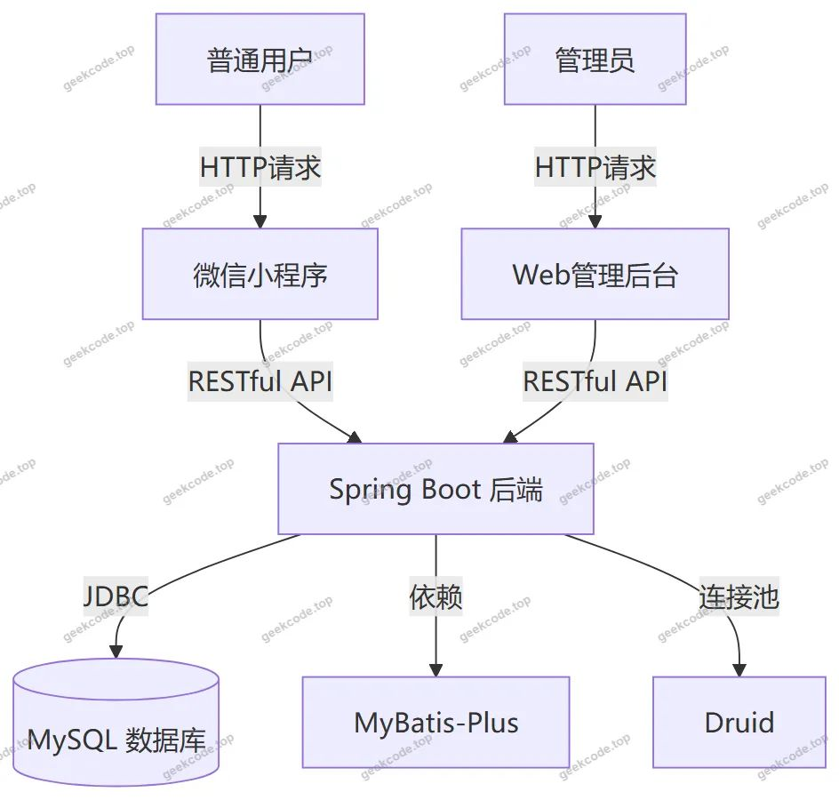</a>

<h2>功能模块</h2>

根据源码 Controller 列表及截图所示，系统功能划分为以下主要模块：

<h3>1. 用户端功能（微信小程序）</h3>
<ul>
<li><strong>首页展示</strong>：呈现轮播图、最新医学知识摘要及快捷入口。</li>
<li><strong>医学知识</strong>：浏览由后台发布的健康科普文章与资讯。</li>
<li><strong>在线留言</strong>：用户可向平台提交咨询意见或反馈，查看回复状态。</li>
<li><strong>个人中心</strong>：</li>
<li><strong>账号管理</strong>：支持注册、登录、忘记密码找回及个人信息修改。</li>
<li><strong>健康信息</strong>：查看个人的健康记录列表及详细信息详情。</li>
<li><strong>健康评估</strong>：参与健康自测问卷，查看评估结果列表及详情报告。</li>
</ul>
<h3>2. 管理端功能（Web 后台）</h3>
<ul>
<li><strong>系统登录</strong>：管理员身份验证入口。</li>
<li><strong>首页概览</strong>：展示关键数据统计或系统状态。</li>
<li><strong>医学知识管理 (<code>/news</code>)</strong>：对健康资讯进行分类、发布、编辑和删除操作。</li>
<li><strong>用户管理 (<code>/yonghu</code>)</strong>：查询注册用户列表，查看用户详情，管理用户状态。</li>
<li><strong>在线留言管理 (<code>/messages</code>)</strong>：审核和处理用户提交的留言内容。</li>
<li><strong>医生管理 (<code>/yisheng</code>)</strong>：维护医生档案信息，包括添加新医生、修改资料及删除记录。</li>
<li><strong>系统配置 (<code>/config</code>)</strong>：管理轮播图等全局参数配置。</li>
<li><strong>健康信息管理 (<code>/jiankangxinxi</code>)</strong>：查阅和管理所有用户的健康数据记录。</li>
<li><strong>健康评估管理 (<code>/jiankangpinggu</code>)</strong>：管理健康评估模板及查看用户的评估历史。</li>
</ul>
<h2>用户角色与权限</h2>

系统主要包含两类角色，不同角色拥有不同的访问权限和功能范围：

<table>
<thead>
<tr>
<th align="left">角色名称</th>
<th align="left">适用场景</th>
<th align="left">可访问功能模块</th>
<th align="left">权限描述</th>
</tr>
</thead>
<tbody><tr>
<td align="left"><strong>普通用户</strong></td>
<td align="left">微信小程序端</td>
<td align="left">首页、医学知识、在线留言、个人中心（注册/登录/忘记密码/个人信息）、健康信息、健康评估</td>
<td align="left">仅能查看公开的健康资讯；只能创建、读取、更新自己的健康信息和评估记录；可以提交留言但无法直接回复他人留言；无权访问其他用户的私密数据。</td>
</tr>
<tr>
<td align="left"><strong>管理员</strong></td>
<td align="left">Web 后台管理系统</td>
<td align="left">全部后台路由 (/news, /yonghu, /messages, /yisheng, /config, /jiankangxinxi, /jiankangpinggu)</td>
<td align="left">拥有最高权限，可对全量数据进行增删改查操作；可发布医学知识、管理医生档案、处理用户留言、配置系统参数；可查看并管理所有用户的健康信息与评估记录。</td>
</tr>
</tbody></table>

<em>注：小程序截图中出现了“管理端-医生列表”、“管理端-用户列表”等页面，表明部分管理功能可能通过特定权限的用户在小程序内也可查看，或者这些截图指的是后台管理系统在移动端的适配视图，但根据常规设计，核心管理操作主要在 Web 后台完成。</em>

<h2>项目特色与创新点</h2>
<ol>
<li><strong>闭环健康管理流程</strong>：项目不仅提供静态的医学知识阅读，还集成了“健康信息记录”与“健康评估”功能，形成了从知识获取到自我监测再到数据分析的完整闭环，帮助用户更直观地了解自身健康状况。</li>
<li><strong>多端协同架构</strong>：采用微信小程序作为 C 端入口，降低了用户使用门槛，无需安装额外 App；同时配备独立的 Web 管理后台，为 B 端管理员提供了高效的批量数据处理能力，实现了前后台职责分离与协同。</li>
<li><strong>模块化权限控制</strong>：通过 <code>CommonController</code> 和 <code>ConfigController</code> 等基础组件，实现了统一的文件上传、系统配置管理及公共接口处理，确保了系统的安全性与可维护性。</li>
<li><strong>实时交互机制</strong>：引入“在线留言”模块，建立了用户与平台之间的即时沟通渠道，增强了系统的服务属性和用户粘性。</li>
</ol>
<h2>部署环境</h2>

为确保项目正常运行，需准备以下软件及硬件环境：

<ol>
<li><strong>开发语言运行时</strong>：</li>
</ol>
<ul>
<li>JDK 1.8 或更高版本（推荐 JDK 8/11，以兼容 Spring Boot 版本）。</li>
</ul>
<ol start="2">
<li><strong>数据库系统</strong>：</li>
</ol>
<ul>
<li>MySQL 5.7 或 8.0+，需初始化相应的表结构（涉及 user, news, yisheng, messages, config, jiankangxinxi, jiankangpinggu 等表）。</li>
</ul>
<ol start="3">
<li><strong>后端构建工具</strong>：</li>
</ol>
<ul>
<li>Maven 3.6+，用于依赖管理和项目打包。</li>
</ul>
<ol start="4">
<li><strong>前端运行环境</strong>：</li>
</ol>
<ul>
<li>Node.js (LTS 版本)，用于编译 Vue 管理后台代码。</li>
<li>微信开发者工具，用于调试和预览微信小程序前端。</li>
</ul>
<ol start="5">
<li><strong>服务器环境</strong>：</li>
</ol>
<ul>
<li>Linux (CentOS/Ubuntu) 或 Windows Server。</li>
<li>Nginx (可选，用于反向代理静态资源)。</li>
</ul>
<ol start="6">
<li><strong>其他依赖</strong>：</li>
</ol>
<ul>
<li>Druid 数据库连接池配置需正确指向 MySQL 实例。</li>
<li>若涉及图片上传，需配置本地存储路径或云存储密钥（依据 <code>FileController</code> 实现而定）。</li>
</ul>
<h2>五、技术特性</h2>
<ul>
<li>前后端集成部署，前端资源打包至后端 static 目录</li>
<li>使用 MyBatis-Plus 简化数据访问层开发</li>
</ul>
<h2>六、功能模块截图</h2>
<h3>微信小程序用户端</h3>

<figure><a href="https://geekcode.top/archives/%E2%80%9C%E5%81%A5%E5%BA%B7%E6%97%A9%E7%9F%A5%E9%81%93%E2%80%9D%E5%BE%AE%E4%BF%A1%E5%B0%8F%E7%A8%8B%E5%BA%8F-%E8%AE%BA%E6%96%87?utm_source=github" title="查看完整源码">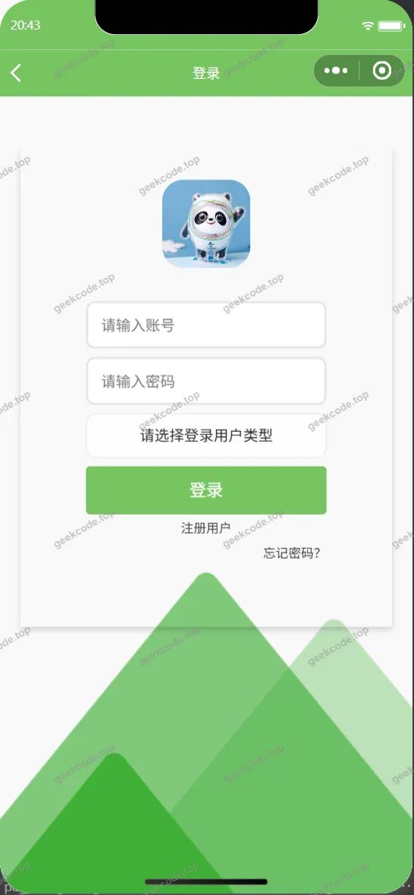</a><figcaption>小程序-登录</figcaption></figure>
<figure><figcaption>小程序-个人信息</figcaption></figure>
<figure><figcaption>小程序-健康评估列表</figcaption></figure>
<figure><a href="https://geekcode.top/archives/%E2%80%9C%E5%81%A5%E5%BA%B7%E6%97%A9%E7%9F%A5%E9%81%93%E2%80%9D%E5%BE%AE%E4%BF%A1%E5%B0%8F%E7%A8%8B%E5%BA%8F-%E8%AE%BA%E6%96%87?utm_source=github" title="查看完整源码">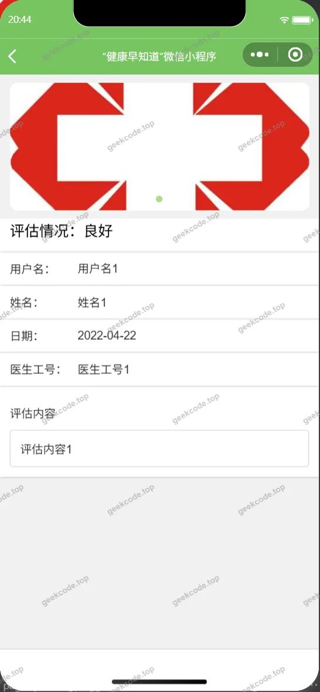</a><figcaption>小程序-健康评估详情</figcaption></figure>
<figure><figcaption>小程序-健康信息列表</figcaption></figure>
<figure><a href="https://geekcode.top/archives/%E2%80%9C%E5%81%A5%E5%BA%B7%E6%97%A9%E7%9F%A5%E9%81%93%E2%80%9D%E5%BE%AE%E4%BF%A1%E5%B0%8F%E7%A8%8B%E5%BA%8F-%E8%AE%BA%E6%96%87?utm_source=github" title="查看完整源码">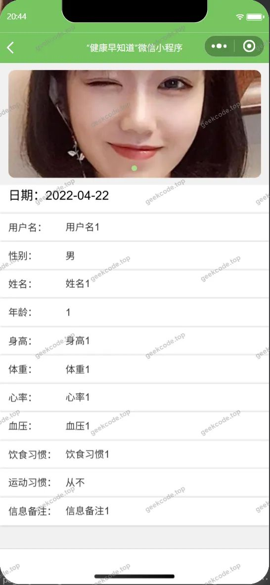</a><figcaption>小程序-健康信息详情</figcaption></figure>
<figure><a href="https://geekcode.top/archives/%E2%80%9C%E5%81%A5%E5%BA%B7%E6%97%A9%E7%9F%A5%E9%81%93%E2%80%9D%E5%BE%AE%E4%BF%A1%E5%B0%8F%E7%A8%8B%E5%BA%8F-%E8%AE%BA%E6%96%87?utm_source=github" title="查看完整源码">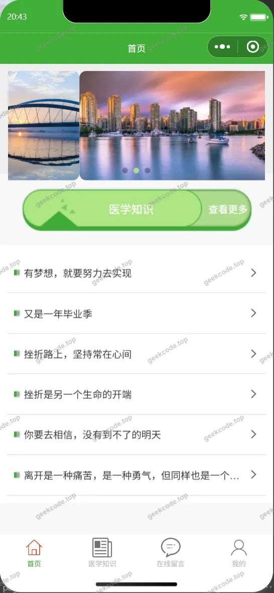</a><figcaption>小程序-首页</figcaption></figure>
<figure><a href="https://geekcode.top/archives/%E2%80%9C%E5%81%A5%E5%BA%B7%E6%97%A9%E7%9F%A5%E9%81%93%E2%80%9D%E5%BE%AE%E4%BF%A1%E5%B0%8F%E7%A8%8B%E5%BA%8F-%E8%AE%BA%E6%96%87?utm_source=github" title="查看完整源码">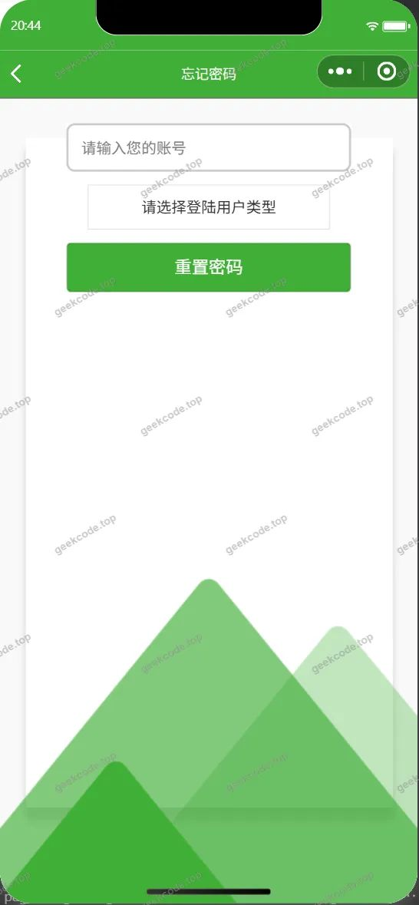</a><figcaption>小程序-忘记密码</figcaption></figure>
<figure><a href="https://geekcode.top/archives/%E2%80%9C%E5%81%A5%E5%BA%B7%E6%97%A9%E7%9F%A5%E9%81%93%E2%80%9D%E5%BE%AE%E4%BF%A1%E5%B0%8F%E7%A8%8B%E5%BA%8F-%E8%AE%BA%E6%96%87?utm_source=github" title="查看完整源码">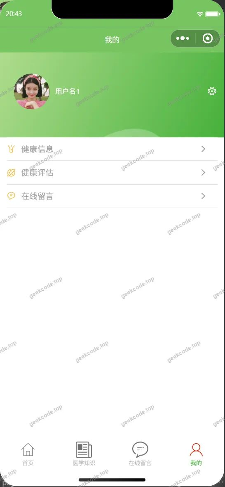</a><figcaption>小程序-我的</figcaption></figure>
<figure><a href="https://geekcode.top/archives/%E2%80%9C%E5%81%A5%E5%BA%B7%E6%97%A9%E7%9F%A5%E9%81%93%E2%80%9D%E5%BE%AE%E4%BF%A1%E5%B0%8F%E7%A8%8B%E5%BA%8F-%E8%AE%BA%E6%96%87?utm_source=github" title="查看完整源码">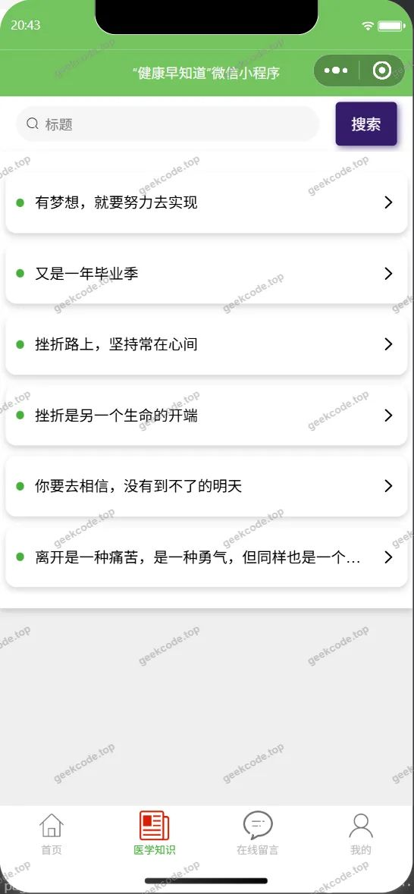</a><figcaption>小程序-医学知识</figcaption></figure>
<figure><a href="https://geekcode.top/archives/%E2%80%9C%E5%81%A5%E5%BA%B7%E6%97%A9%E7%9F%A5%E9%81%93%E2%80%9D%E5%BE%AE%E4%BF%A1%E5%B0%8F%E7%A8%8B%E5%BA%8F-%E8%AE%BA%E6%96%87?utm_source=github" title="查看完整源码">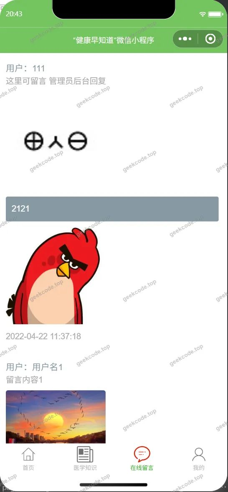</a><figcaption>小程序-在线留言</figcaption></figure>
<figure><a href="https://geekcode.top/archives/%E2%80%9C%E5%81%A5%E5%BA%B7%E6%97%A9%E7%9F%A5%E9%81%93%E2%80%9D%E5%BE%AE%E4%BF%A1%E5%B0%8F%E7%A8%8B%E5%BA%8F-%E8%AE%BA%E6%96%87?utm_source=github" title="查看完整源码">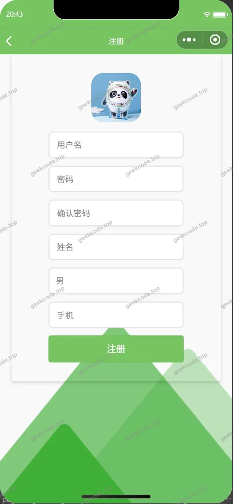</a><figcaption>小程序-注册</figcaption></figure>

<h3>微信小程序管理端</h3>

<figure><figcaption>小程序-管理端-医生列表</figcaption></figure>
<figure><figcaption>小程序-管理端-医生详情</figcaption></figure>
<figure><figcaption>小程序-管理端-用户列表</figcaption></figure>
<figure><figcaption>小程序-管理端-用户详情</figcaption></figure>

<h3>后台管理端</h3>
<h4>后台-系统配置</h4>

<a href="https://geekcode.top/archives/%E2%80%9C%E5%81%A5%E5%BA%B7%E6%97%A9%E7%9F%A5%E9%81%93%E2%80%9D%E5%BE%AE%E4%BF%A1%E5%B0%8F%E7%A8%8B%E5%BA%8F-%E8%AE%BA%E6%96%87?utm_source=github" title="查看完整源码">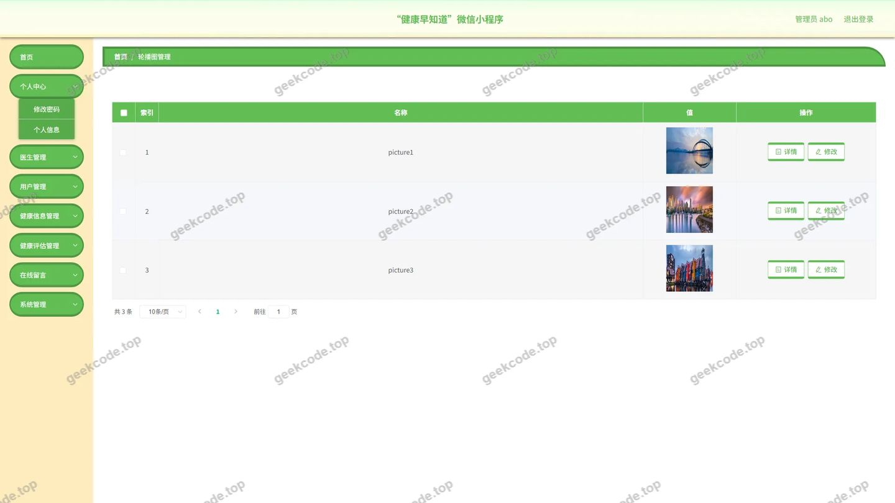</a>

<h4>后台首页</h4>

<h4>后台-健康评估</h4>

<a href="https://geekcode.top/archives/%E2%80%9C%E5%81%A5%E5%BA%B7%E6%97%A9%E7%9F%A5%E9%81%93%E2%80%9D%E5%BE%AE%E4%BF%A1%E5%B0%8F%E7%A8%8B%E5%BA%8F-%E8%AE%BA%E6%96%87?utm_source=github" title="查看完整源码">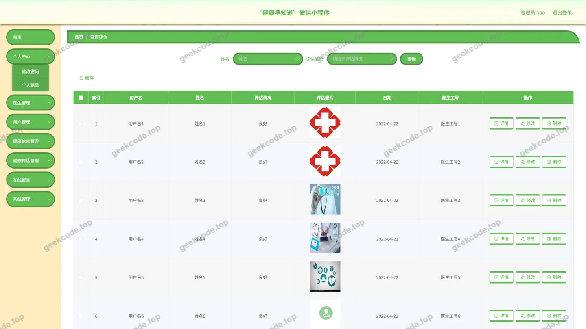</a>

<h4>后台-健康信息</h4>

<a href="https://geekcode.top/archives/%E2%80%9C%E5%81%A5%E5%BA%B7%E6%97%A9%E7%9F%A5%E9%81%93%E2%80%9D%E5%BE%AE%E4%BF%A1%E5%B0%8F%E7%A8%8B%E5%BA%8F-%E8%AE%BA%E6%96%87?utm_source=github" title="查看完整源码">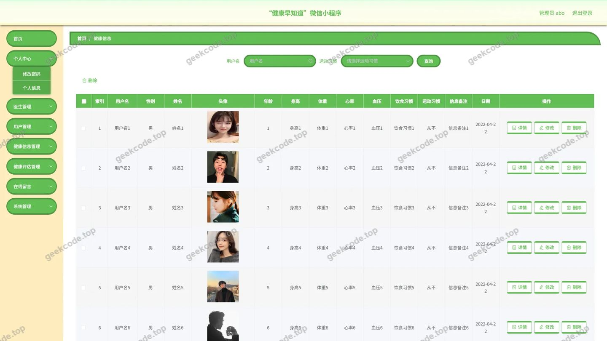</a>

<h4>后台-登录</h4>

<a href="https://geekcode.top/archives/%E2%80%9C%E5%81%A5%E5%BA%B7%E6%97%A9%E7%9F%A5%E9%81%93%E2%80%9D%E5%BE%AE%E4%BF%A1%E5%B0%8F%E7%A8%8B%E5%BA%8F-%E8%AE%BA%E6%96%87?utm_source=github" title="查看完整源码">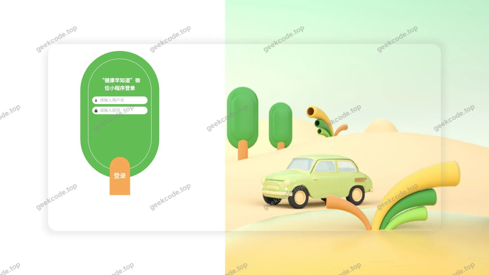</a>

<h4>后台-留言板</h4>

<a href="https://geekcode.top/archives/%E2%80%9C%E5%81%A5%E5%BA%B7%E6%97%A9%E7%9F%A5%E9%81%93%E2%80%9D%E5%BE%AE%E4%BF%A1%E5%B0%8F%E7%A8%8B%E5%BA%8F-%E8%AE%BA%E6%96%87?utm_source=github" title="查看完整源码">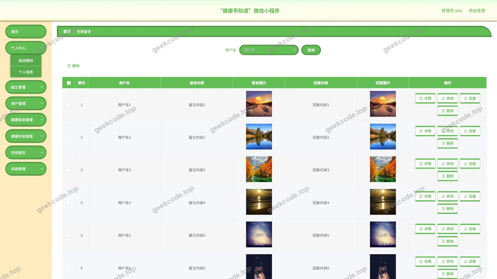</a>

<h4>后台-公告信息</h4>

<a href="https://geekcode.top/archives/%E2%80%9C%E5%81%A5%E5%BA%B7%E6%97%A9%E7%9F%A5%E9%81%93%E2%80%9D%E5%BE%AE%E4%BF%A1%E5%B0%8F%E7%A8%8B%E5%BA%8F-%E8%AE%BA%E6%96%87?utm_source=github" title="查看完整源码">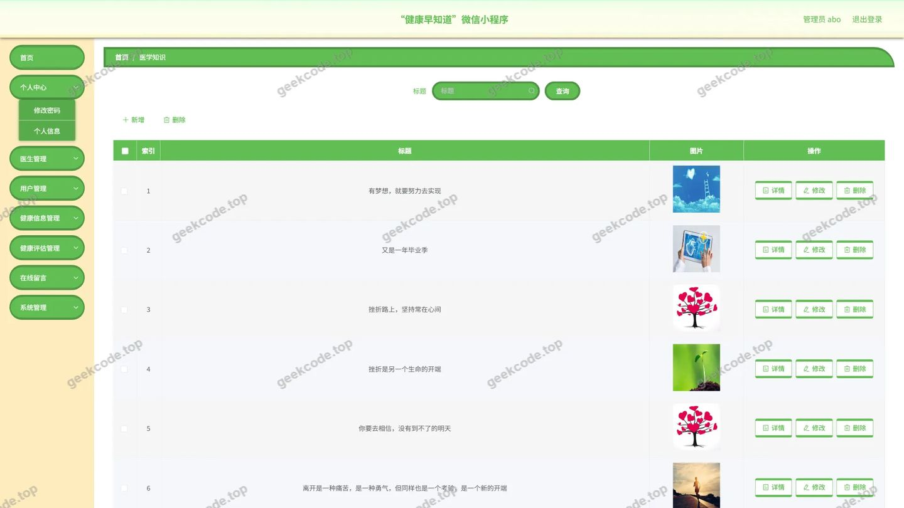</a>

<h4>后台-医生</h4>

<a href="https://geekcode.top/archives/%E2%80%9C%E5%81%A5%E5%BA%B7%E6%97%A9%E7%9F%A5%E9%81%93%E2%80%9D%E5%BE%AE%E4%BF%A1%E5%B0%8F%E7%A8%8B%E5%BA%8F-%E8%AE%BA%E6%96%87?utm_source=github" title="查看完整源码">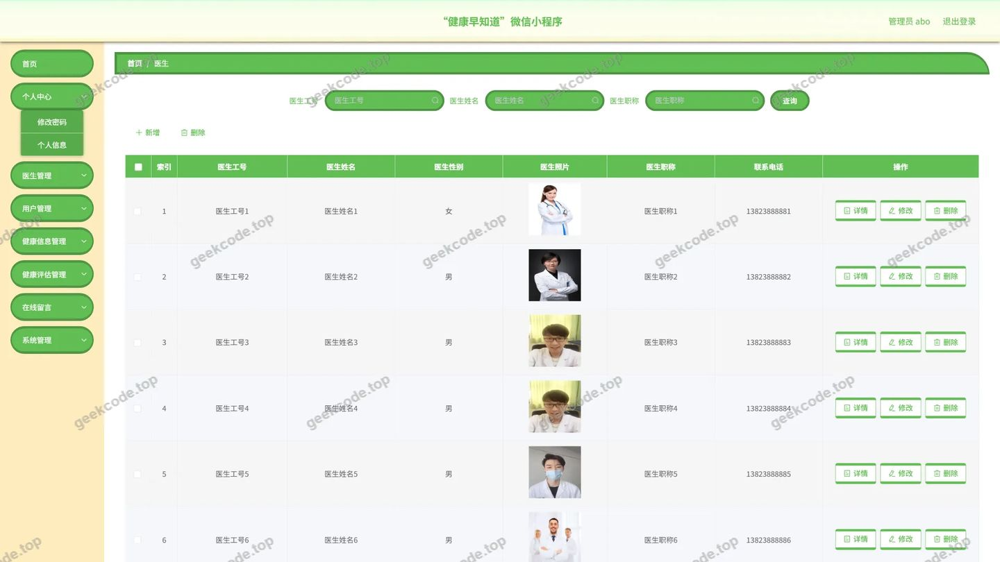</a>

---

## 获取完整源码

| 项目 | 说明 |
| --- | --- |
| 项目名 | “健康早知道”微信小程序--论文 |
| 运行截图 | 本文 25 张（站点带水印原图，仓库 `images/` 目录） |
| 完整源码 | [https://geekcode.top/archives/%E2%80%9C%E5%81%A5%E5%BA%B7%E6%97%A9%E7%9F%A5%E9%81%93%E2%80%9D%E5%BE%AE%E4%BF%A1%E5%B0%8F%E7%A8%8B%E5%BA%8F-%E8%AE%BA%E6%96%87?utm_source=github](https://geekcode.top/archives/%E2%80%9C%E5%81%A5%E5%BA%B7%E6%97%A9%E7%9F%A5%E9%81%93%E2%80%9D%E5%BE%AE%E4%BF%A1%E5%B0%8F%E7%A8%8B%E5%BA%8F-%E8%AE%BA%E6%96%87?utm_source=github) |
| 咨询微信 | **ir9372**（备注：jingpin-yuanma） |
| 更多项目 | [极客代码 geekcode.top](https://geekcode.top/?utm_source=github) |

> 需要源码、部署、改配置、跑不起来等问题，加微信 ir9372 沟通，说明项目名即可。
